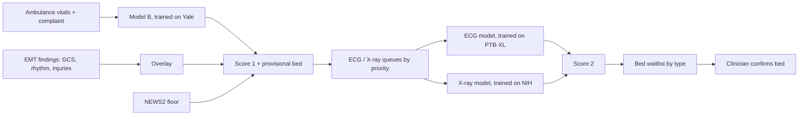

# Triagent AI

> Prototype branch of the team repo. It does not follow `docs/CONTRACT.md` (different score formula, bed types and API paths). Everything below is relative to this `prototype/` folder.

**SacHacks HackRx 2026 · Best Clinical Impact track · proof of concept**

Triagent AI follows an emergency patient from the ambulance to a hospital bed with one shared record and one risk score.

1. **Ambulance.** The crew enters vitals, chief complaint, GCS, rhythm, visible injuries, history, medications, allergies and treatments. The app gives a **1–100 risk score** and a **provisional bed request**.
2. **Handoff at the ER door.** The whole record arrives digitally, so nothing is lost on paper.
3. **ECG and chest X-ray queues** are ordered by risk. Chest pain still gets an ECG within 10 minutes, regardless of score.
4. **Re-score.** ECG and X-ray models adjust the score. Bad findings raise it; reassuring findings can lower it only a little, never when the model is unsure, and never below what the vital signs demand.
5. **Bed waitlists by bed type** (ICU, CCU, Telemetry, Psychiatric, General ward). An ER clinician confirms the bed type; the app never assigns a bed on its own.
6. **Second handoff** to the admitting team, with the full record and score history.

## Datasets (track requirement: Yale + 2 of the other 3)

| Dataset | What we trained | Test result |
|---|---|---|
| [Yale ED Admission Prediction](https://github.com/yaleemmlc/admissionprediction) (560k ED visits) | Ambulance risk score: Model B (vitals + complaint) and Model A (vitals only) | AUROC **0.791** (B), **0.749** (A) |
| [PTB-XL](https://physionet.org/content/ptb-xl/1.0.3/) (21.8k 12-lead ECGs) | ECG model, 5 diagnostic classes | Macro AUROC **0.921** (published benchmark ~0.92–0.93) |
| [NIH ChestX-ray14](https://huggingface.co/datasets/alkzar90/NIH-Chest-X-ray-dataset) (subset, 4,999 images) | Chest X-ray model, 14 findings | Macro AUROC **0.708** |

Benchmark: NEWS2 computed from the same vitals reaches AUROC 0.621 for admission.

## Our data finding

The Yale medication-count columns look like a strong predictor (they push AUROC to 0.904), but **90% of discharged patients have zero recorded medications versus 33% of admitted patients**, even among patients over 65 on their first visit (81% zero). That pattern fits medication lists being filled in during admission, which leaks the outcome. We removed them. The honest ambulance-available AUROC is 0.79, not 0.90. See [docs/RESULTS.md](docs/RESULTS.md).

## How it works



Every formula, with every weight: [docs/FORMULAS.md](docs/FORMULAS.md). All formulas live in one file of code: `app/scoring.py`.

## Run it

Windows: double-click `run.bat`. Mac/Linux: `./run.sh`. Or:

```
pip install -r requirements.txt
python -m uvicorn app.server:app --port 8000
```

Open http://localhost:8000. Six fictional example patients load on start; **Reset demo** restores them.

**Model weights.** `outputs/ecg_resnet1d.pt` and `outputs/cxr_densenet121.pt` are not committed (team repo rule). Without them the site still runs; the ECG and X-ray steps show a notice. To recreate them, download PTB-XL into `data/ptbxl` and NIH `images_001.zip` + `Data_Entry_2017_v2020.csv` into `data/nih`, then:

```
python src/ecg_train.py
python src/cxr_train.py
python src/calibrate.py
```

Tests: `python -m pytest -q` (12 tests: NEWS2, safety floor, drop caps, bed rules, worked examples).

## Reproduce the models

| Step | Script | Output |
|---|---|---|
| Yale full model + leakage check | `src/yale_baseline.py`, `src/yale_ablation.py` | `outputs/yale_*.json` |
| Ambulance scorecard (Models A and B) | `src/vitals_scorecard.py` | `outputs/vitals_scorecard.json` |
| ECG model | `src/ecg_train.py` | `outputs/ecg_*` |
| X-ray model | `src/cxr_train.py` | `outputs/cxr_*` |
| Calibration | `src/calibrate.py` | `outputs/calibration.json` |
| Demo samples (held-out test data only) | `src/build_samples.py` | `app/samples/` |

## Limitations

- Yale vitals are **ER triage** vitals of ambulance arrivals, used as a stand-in for ambulance-recorded vitals. Validation on real EMS data is the next step.
- The models predict **admission, not severity**. Severe trauma is caught by the EMT overlay and the NEWS2 floor, not the model.
- The three datasets come from different patients, so there is no single combined model. They are joined by written rules.
- Overlay weights, ECG/X-ray severity weights and bed-type rules are **hand-set clinical choices** awaiting clinician review. No dataset links imaging to outcomes or records the admitting unit.
- The X-ray model was trained on 4% of NIH, so in this prototype it may only raise scores.
- A score does not create beds. We do not claim shorter waits; we claim the sickest patient is seen first and information is not lost between handoffs.
- Demo patients are fictional. A real system would need role-based access control (HIPAA).

## Repository layout

```
app/        website: scoring.py (formulas), server.py (API + inference), static/ (frontend), samples/
src/        training and evaluation scripts
outputs/    metrics, calibration, Yale model (weights not committed)
tests/      scoring tests
docs/       FORMULAS.md, RESULTS.md
pitch/      SUBMISSION.md (Devpost text), DEMO_SCRIPT.md
```

## Citations

- Hong WS, Haimovich AD, Taylor RA. Predicting hospital admission at emergency department triage using machine learning. *PLoS ONE* 13(7): e0201016, 2018.
- Wagner P, et al. PTB-XL, a large publicly available electrocardiography dataset. *Scientific Data* 7:154, 2020. PhysioNet, doi:10.13026/kfzx-aw45.
- Strodthoff N, et al. Deep learning for ECG analysis: benchmarks and insights from PTB-XL. *IEEE JBHI*, 2021.
- Wang X, et al. ChestX-ray8: Hospital-scale chest X-ray database and benchmarks. *CVPR*, 2017.
- Royal College of Physicians. National Early Warning Score (NEWS) 2. London, 2017.
